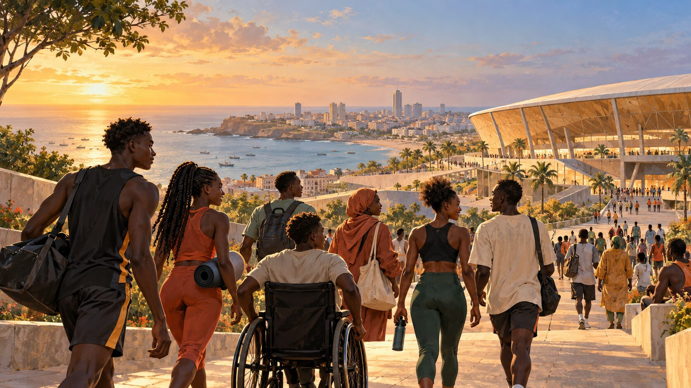
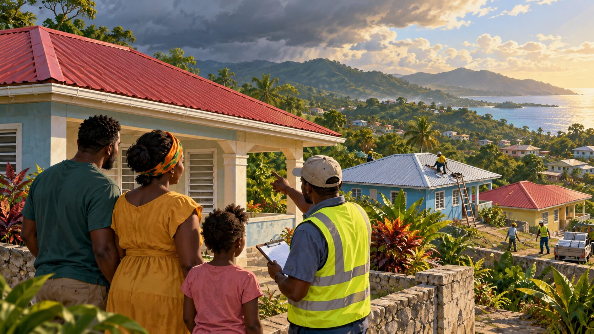
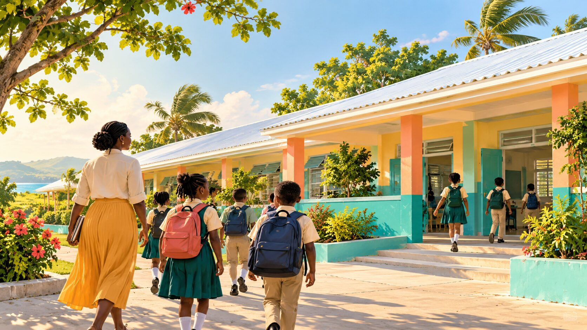

# Afrodescendant Ali RSS Writing Samples — 2026-10-28

Status: SAMPLE — UNPUBLISHED
Project: PM-009 — AfrodescendantAli.com
Editorial basis: RSS discovery → original reporting/context → source attribution → human review

These samples were developed from retained-feed items collected on 2026-10-28. They are demonstrations of voice and structure, not approved news stories. No source text, image or media has been copied. Each sample now has a clearly labeled Afrodescendant Ali editorial illustration; these visuals are conceptual, not documentary photographs.

---

## Sample 1 — Africa / Analysis

### Dakar’s Youth Olympics are a continental milestone. The welcome must be measured by who feels included.

**Dek:** Senegal is preparing to host Africa’s first Olympic sporting event. The larger question is whether the promise of welcome will extend beyond the ceremony.

**By Afrodescendant Ali | Analysis sample | Unpublished**

*Illustration — not documentary photography. Credit: Afrodescendant Ali editorial illustration, generated for sample use, 2026-10-28.*

**Image record:** IMG-20261028-001 | Image status: IMAGE_FALLBACK_ONLY | Rights state: fallback_only | Alt text: Young Black African athletes and residents move toward a shared sporting venue overlooking Dakar’s coast. | The illustration represents inclusion and participation; it does not depict a specific real event.

When the Youth Olympic Games open in Senegal on October 31, Dakar will host a sporting event that carries meaning beyond the competition. The 2026 Games are scheduled across Dakar, Diamniadio and Saly, with approximately 2,700 young athletes expected to participate in 25 sports.

That makes the event a continental milestone. It also makes the language around the Games matter.

The International Olympic Committee describes Dakar 2026 as an opportunity to place young people, sport and culture at the centre of a wider African story. AllAfrica’s published commentary asks a harder question: what does “welcome” mean when rights concerns remain part of the country’s public debate?

That question should not be treated as a distraction from the Games. It is part of the context in which the Games will be experienced by athletes, residents, visitors and communities whose lives do not fit neatly into a ceremonial slogan.

The event can still be a source of pride. But pride is strongest when it can withstand scrutiny. Senegal’s challenge is to make the promise of hospitality visible not only in stadiums and opening ceremonies, but also in the safety, dignity and equal treatment of the people who live there.

The next test will be practical: how the authorities, Olympic bodies and local institutions respond when inclusion moves from a word on a banner to a responsibility toward real people.

**Source record**

- RSS discovery source: AllAfrica — “Senegal’s Youth Olympics’ Welcome Should Include Everyone”
- RSS item: https://allafrica.com/stories/202610280276.html
- Primary context source: Dakar 2026 Media Kit, International Olympic Committee
- Primary source: https://www.olympics.com/ioc/media/dakar-2026-media-kit
- Source access date: 2026-10-28
- Rights state: discovery and link-only review; no source text or media reused

**Claim notes**

- Confirmed: Dakar 2026 is scheduled for October 31–November 13, 2026.
- Confirmed: The IOC identifies Dakar 2026 as the first Olympic sporting event held in Africa.
- Attributed: The inclusion and rights concern is framed as a question raised by the AllAfrica commentary and other reporting.
- Editorial interpretation: The final two paragraphs are Afrodescendant Ali analysis, not a claim about an official position.

---

## Sample 2 — Caribbean / News Brief

### Jamaica’s roof-recovery programme is entering its deadline phase

**Dek:** A new government allocation is meant to move thousands of hurricane-affected households through the next stage of assistance. The difficult part will be completing verification and payments on time.

**By Afrodescendant Ali | News brief sample | Unpublished**

*Illustration — not documentary photography. Credit: Afrodescendant Ali editorial illustration, generated for sample use, 2026-10-28.*

**Image record:** IMG-20261028-002 | Image status: IMAGE_FALLBACK_ONLY | Rights state: fallback_only | Alt text: A Jamaican family and community worker review roof repairs in a hillside neighborhood after a storm. | The illustration represents housing recovery; it does not depict a specific household or government programme site.

Jamaica’s government has announced an additional $9.65 billion for the Restoration of Owner and Occupant Family Shelter programme, according to the Jamaica Observer.

The programme is intended to support households whose homes were damaged by Hurricane Melissa. The report says more than 118,000 households have been assessed, with roughly half having received assistance. The government has set a target of reaching 90 per cent of assessed households by the end of December and completing the remaining cases by the end of January.

The programme’s grants vary according to the level of damage, from $75,000 for minor damage to $500,000 for severe damage. Payments remain subject to verification, reassessment and other administrative checks.

That condition is central to the recovery story. A funding announcement can show political intent, but it does not show whether a family has received a roof, whether the payment arrived in time, or whether the assessment process is working fairly.

The next reporting question is therefore measurable: how many households receive assistance each month, where the delays occur, and whether the government’s December and January targets are met.

**Source record**

- RSS discovery source: Jamaica Observer — “Holness pumps another $9.65b into ROOFS”
- Direct source: https://www.jamaicaobserver.com/2026/10/28/holness-pumps-another-9-65b-roofs/
- Source access date: 2026-10-28
- Rights state: link-only RSS terms reviewed; original article text and media not reused

**Claim notes**

- Attributed: Funding, household counts, targets and grant amounts are reported by Jamaica Observer from government statements.
- Unresolved: The sample does not independently verify the number of households paid or the government’s expenditure figures.
- Editorial wording deliberately uses “according to” and “reported” rather than presenting government figures as independently established facts.

---

## Sample 3 — Caribbean / Community Recovery

### In western Jamaica, school repairs turn hurricane recovery into a question of continuity

**Dek:** Two schools have completed restoration work after Hurricane Melissa, while a new funding commitment aims to extend repairs to more students and communities.

**By Afrodescendant Ali | Community recovery sample | Unpublished**

*Illustration — not documentary photography. Credit: Afrodescendant Ali editorial illustration, generated for sample use, 2026-10-28.*

**Image record:** IMG-20261028-003 | Image status: IMAGE_FALLBACK_ONLY | Rights state: fallback_only | Alt text: Jamaican students with backpacks walk toward a repaired school building with a teacher. | The illustration represents continuity after storm recovery; it does not depict a named school or identifiable children.

At Little London High School in Westmoreland and Mayfield Primary and Infant School in St Elizabeth, recovery has moved from emergency response to the slower work of making daily education possible again.

The Jamaica Observer reports that restoration work valued at approximately $50.4 million has been completed at the two schools. The Sagicor Foundation has also announced another $30 million for school restoration, building on funds raised through the 2026 Sagicor Sigma Corporate Run.

The repairs are part of a wider effort involving five schools. The remaining three—Hopewell High, Green Pond High and Salt Marsh Primary and Infant—were described as nearing completion.

The numbers matter, but the human measure is simpler. Can students return to classrooms that are safe enough for concentration? Can teachers plan beyond the next storm? Can a community treat recovery as the restoration of opportunity rather than only the replacement of damaged infrastructure?

The answer will depend on what happens after the handover ceremonies. Schools need functioning buildings, but they also need continuity: reliable funding, coordinated public agencies and attention to the children whose education was interrupted.

For western Jamaica, the next chapter of recovery will be visible in attendance, learning and the everyday confidence of students and families.

**Source record**

- RSS discovery source: Jamaica Observer — “Sagicor delivers double boost to Melissa-hit schools”
- Direct source: https://www.jamaicaobserver.com/2026/10/28/sagicor-delivers-double-boost-melissa-hit-schools/
- Source access date: 2026-10-28
- Rights state: link-only RSS terms reviewed; original article text, quotations, image and media not reused

**Claim notes**

- Attributed: Restoration values, schools, fundraising totals and funding commitments are reported by Jamaica Observer from Sagicor Foundation and partner statements.
- Editorial interpretation: The questions about continuity, attendance and learning are an editorial frame, not reported outcomes.
- Not claimed: This sample does not state that the repaired schools have achieved improved educational outcomes.

---

## Editorial review status

All three samples remain:

- unpublished;
- non-indexable;
- outside automatic publication;
- subject to source, rights, claim, copy and mobile QA;
- unsuitable for public release until an editor approves them.
